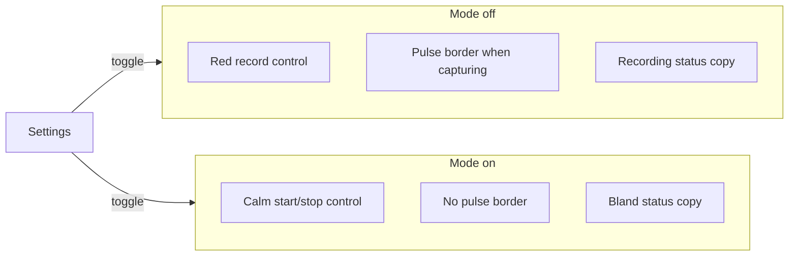

# Incognito mode (discreet capture chrome)

## Goal Capsule

**Objective:** During an in-person meeting with people nearby, the user can leave a Settings-toggled discreet mode on for the whole session and start or stop capture without the app reading as a recorder at a glance — while still knowing capture is active.

**Means:** Quiet the in-app capture chrome (start/stop control, recording pulse, status tone) when the mode is on; leave window title and taskbar identity unchanged.

**Product authority:** This plan owns only discreet capture chrome. Transcript-pane hide and continue-recording after switching meetings are surrounding work, not active scope.

**Open blockers:** None.

## Product Contract

### Summary

Add a persistent Settings toggle for “incognito” (discreet) mode. While on, capture chrome looks calm and note-like: no red pulsing recording border, a non-red start/stop control that still shows idle vs active, and bland status copy — so a neighbor glance or a quick flip to hit start does not scream “recording app.”

### Problem Frame

Users sometimes sit next to others in long meetings and briefly switch to Rapid Scribe to start capture. Today that flash is loud: a red record control, a pulsing red transcript border, and “Recording…”-style status. Workarounds include dimming the screen and flipping away as fast as possible. The need is whole-meeting discreetness (hours), not a one-second camouflage.

### Key Decisions

- **KD1. Settings-only toggle** — Persist on/off in Settings; no main-chrome switch in v1. `(session-settled: user-directed — chosen over in-chrome or both: set once for the meeting day)` Governs R1.
- **KD2. In-app chrome only** — Do not rename window title, taskbar, icon, or installer identity. `(session-settled: user-approved — chosen over disguising OS identity: pain was red control and pulse; OS rename makes the app harder to find)` Governs R6.
- **KD3. Confidence via control state** — Active capture is shown on the start/stop control (calm stop/active affordance), not via red pulse or loud “Recording…” status. `(session-settled: user-approved — chosen over status-only or no indicator: multi-hour confidence without glanceable recorder cues)` Governs R3, R4, R5.
- **KD4. Quiet chrome first** — Defer transcript hide and continue-on-other-meeting. `(session-settled: user-directed — chosen over bundling those into this PR: ship quieter chrome alone)` Governs Scope Boundaries.

### How This Work Fits Together

<!-- ce-section: work-relationships -->

This plan covers **discreet capture chrome** only. The broader discreet-meeting picture is current understanding, not a roadmap:

- **Hide transcript pane while capture continues**
  - Can proceed independently of this plan once chrome quieting exists (or in parallel if desired)
  - Shares the same “neighbor glance” motivation
- **Keep appending transcript to the meeting where recording started after the user selects another meeting**
  - Can proceed independently of this plan
  - Still to decide: interaction with any future hide-transcript UI

### Requirements

**Mode control**

- R1. The user can turn discreet mode on or off from Settings; the choice persists across app restarts until changed.
- R2. Turning the mode on or off applies immediately to capture chrome (including during an active session): pulse, control styling, and status tone follow the current setting without requiring a restart.

**Capture chrome while mode is on**

- R3. The transcript/log does not show the red pulsing recording border while discreet mode is on, whether idle or capturing.
- R4. The start/stop control does not use red / danger “recorder” styling while discreet mode is on; idle and active/stop states remain visually distinct via a calm treatment.
- R5. While capturing with discreet mode on, status text must not advertise recording in plain language (no “Recording…” / “Recording & transcribing…” style strings); prefer bland copy such as “On” or elapsed-time-only if a status line remains.
- R6. Window title, taskbar/dock label, and app icon stay the normal Rapid Scribe identity regardless of mode.

**Mode off**

- R7. With discreet mode off, existing capture chrome behavior is unchanged (including red pulse when recording and current record/stop presentation).

### Key Flows

1. **Enable before a meeting** — User opens Settings, turns discreet mode on, returns to the main surface. Start control is already calm; no pulse at idle.
2. **Start capture with people nearby** — User briefly focuses the app and activates start. Control moves to calm active/stop; status stays bland; transcript has no red pulse. User can leave the window visible or switch away.
3. **Multi-hour session** — Capture stays active; user confirms “still on” from the control’s active/stop state, not from pulse or “Recording…” text.
4. **Disable** — User turns the mode off in Settings; chrome returns to normal recorder presentation (R7), including pulse if still capturing.

### Acceptance Examples

- AE1. **When** discreet mode is on and the user starts capture, **then** the transcript border does not pulse red and the start/stop control is not red/danger-styled, yet the control still indicates active/stop (covers R3, R4).
- AE2. **When** discreet mode is on during capture, **then** the status line does not contain recording-advertising wording (covers R5).
- AE3. **When** discreet mode is on, **then** the window title still identifies Rapid Scribe as today (covers R6).
- AE4. **When** the user turns discreet mode on mid-capture, **then** any red pulse stops and control/status adopt discreet presentation without restarting the app (covers R2).
- AE5. **When** discreet mode is off, **then** starting capture still shows the existing red pulse and record/stop presentation (covers R7).

### Success Criteria

- User can start capture in a shared space without dimming the screen as a workaround.
- A brief neighbor glance at the focused window does not read primarily as “a recording app”; it reads closer to ordinary notes/tooling.
- User remains confident capture is running during a multi-hour meeting via the calm active/stop control state.

### Scope Boundaries

**In scope:** Settings-persisted discreet mode; quieting of start/stop styling, recording pulse, and capture status tone; immediate apply on toggle.

**Deferred for later**

- Hide / collapse the transcript pane while capture continues
- Continue appending transcript to the meeting where recording was started after selecting a different meeting in the sidebar

**Out of scope**

- Changing window title, taskbar/dock name, app icon, installer name, or `.desktop` categories/keywords
- System tray / minimize-to-tray
- Broad copy rewrite of Meetings / AI Summary / other non-capture chrome into “notes app” language
- Changing audio capture, transcription, or persistence behavior

### Outstanding Questions

**Deferred to Planning**

- Exact Settings label/copy for the toggle (“Incognito mode” vs “Discreet mode” vs similar)
- Exact calm colors/icons for idle vs active/stop (within R4: non-red, distinct states)
- Exact bland status strings when capturing vs idle (within R5)
